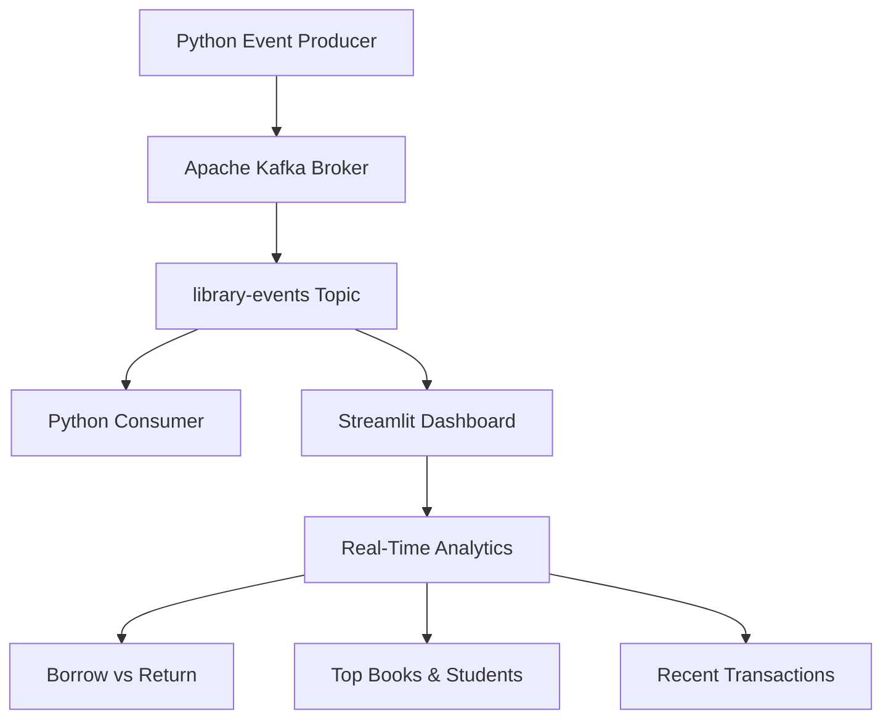

# 📚 Library Real-Time Monitoring System

A real-time library transaction monitoring system built using **Apache Kafka, Python, and Streamlit**. The application simulates library book borrowing and returning events, streams them through Kafka, and presents live transaction analytics through an interactive dashboard.

## 🚀 Project Overview

Traditional library transaction monitoring often relies on manually updated records, making real-time tracking and analysis difficult.

This project demonstrates how Apache Kafka can be used as an event-streaming platform to process library transactions in real time.

A Python producer generates simulated library events and publishes them to a Kafka topic. Independent Kafka consumers process these events, while a Streamlit dashboard visualizes transaction activity and analytics.

## 🏗️ System Architecture



### Event Processing Workflow

1. **Event Generation:** Python generates simulated library transactions using Faker and random data generation.
2. **Event Streaming:** The Kafka producer serializes transaction data into JSON and publishes it to the `library-events` topic.
3. **Event Storage:** Apache Kafka stores the published records in topic partitions.
4. **Event Consumption:** Independent Kafka consumers subscribe to the topic and retrieve transaction events.
5. **Data Visualization:** Streamlit consumes Kafka events and displays real-time statistics and interactive analytics.

## ✨ Features

- Real-time library transaction event generation.
- Apache Kafka producer and consumer integration.
- JSON-based event serialization and deserialization.
- Kafka topic and partition monitoring.
- Live transaction monitoring.
- Borrow and return transaction statistics.
- Interactive filters by action, book, and student.
- Top 5 most borrowed books.
- Top 5 active students.
- Latest transaction tracking.
- Recent transaction history.
- Automatic dashboard refresh.

## 🛠️ Tech Stack

| Technology | Purpose |
|---|---|
| Python | Application development |
| Apache Kafka 4.3.1 | Event streaming and message storage |
| kafka-python | Kafka producer and consumer integration |
| Streamlit | Interactive monitoring dashboard |
| Faker | Simulated student data generation |
| Pandas / Collections | Data handling and analytics |
| JSON | Event serialization |

## 📂 Project Structure

```text
library-realtime-monitoring-kafka/
│
├── producer.py          # Generates and publishes events
├── consumer.py          # Consumes Kafka messages
├── dashboard.py         # Streamlit monitoring dashboard
├── requirements.txt     # Python dependencies
├── README.md            # Project documentation
└── .gitignore           # Git ignored files
```

## ⚙️ Installation and Setup

### Prerequisites

- Python 3.11 or later
- Apache Kafka 4.3.1
- Java runtime compatible with your Kafka distribution
- Git
- Windows CMD or PowerShell

### 1. Clone the Repository

```bash
git clone https://github.com/YOUR_USERNAME/library-realtime-monitoring-kafka.git

cd library-realtime-monitoring-kafka
```

Replace `YOUR_USERNAME` with your GitHub username.

### 2. Create a Virtual Environment

```bash
python -m venv venv
```

Activate it on Windows PowerShell:

```powershell
.\venv\Scripts\Activate.ps1
```

### 3. Install Dependencies

```bash
pip install -r requirements.txt
```

### 4. Start Apache Kafka

Download and extract Apache Kafka 4.3.1.

Kafka uses KRaft mode, so ZooKeeper is not required.

If setting up a fresh Kafka installation, format its storage using the Kafka storage tool and the configuration appropriate to your installation.

Start the Kafka broker:

```bash
bin\windows\kafka-server-start.bat config\server.properties
```

### 5. Create the Kafka Topic

Open another terminal and execute:

```bash
bin\windows\kafka-topics.bat --create --topic library-events --bootstrap-server localhost:9092
```

Verify the topic:

```bash
bin\windows\kafka-topics.bat --list --bootstrap-server localhost:9092
```

### 6. Run the Python Producer

Open a new terminal in the project directory:

```bash
python producer.py
```

The producer continuously generates simulated library transactions and publishes them to Kafka.

### 7. Run the Python Consumer

Open another terminal:

```bash
python consumer.py
```

The consumer subscribes to the `library-events` topic and displays incoming transactions.

### 8. Launch the Streamlit Dashboard

Open another terminal:

```bash
streamlit run dashboard.py
```

Open the dashboard in your browser:

```text
http://localhost:8501
```

**Note:** Start the producer before launching the dashboard to ensure new events are available for live visualization.

## 📊 Sample Event Structure

Each library transaction is represented as a JSON event.

```json
{
  "student_id": "23ISE045",
  "student_name": "John Smith",
  "book_id": "BK001",
  "book_name": "Database Management Systems",
  "action": "BORROW",
  "timestamp": "2026-11-01 10:30:00"
}
```

Possible transaction actions:

- `BORROW`
- `RETURN`

## 📸 Dashboard Preview

The Streamlit dashboard provides:

- Kafka data pipeline visualization.
- Kafka broker and topic status.
- Real-time transaction filters.
- Borrow vs. return analytics.
- Most borrowed book statistics.
- Student activity analysis.
- Latest and recent transaction records.

> Add your actual dashboard screenshots here after uploading them to the repository.

## 🎯 Learning Outcomes

Through this project, we explored:

- Apache Kafka fundamentals and event streaming.
- Kafka producers, consumers, topics, partitions, and offsets.
- JSON-based message processing.
- Independent consumer groups.
- Real-time data ingestion and visualization.
- Building interactive monitoring dashboards using Streamlit.

## ⚠️ Project Scope and Limitations

- Library transactions are simulated rather than collected from a real library management system.
- Analytics are maintained in Streamlit session state and limited to the latest 100 events.
- Kafka is configured as a local single-broker demonstration environment.
- The project does not currently use a persistent analytical database.

## 👩‍💻 Author

**Poorvika N P**

Information Science and Engineering

GitHub: [Poorvikannp](https://github.com/Poorvikannp)

---

⭐ If you find this project interesting, consider giving the repository a star!
